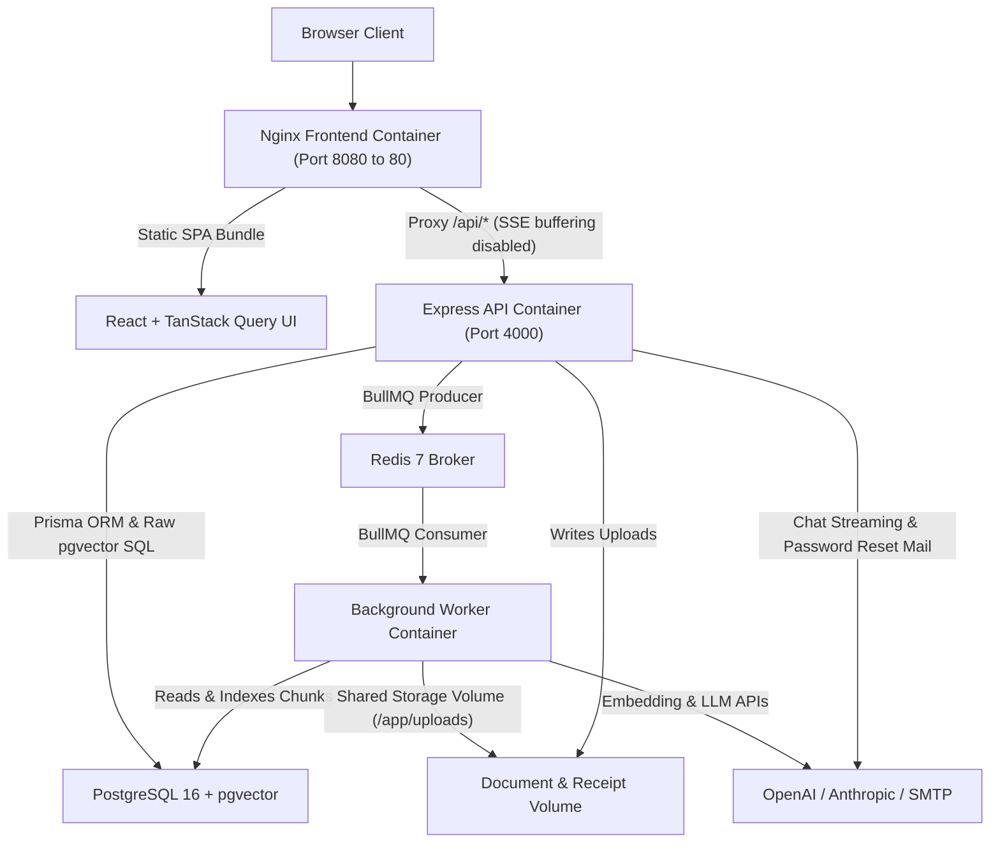
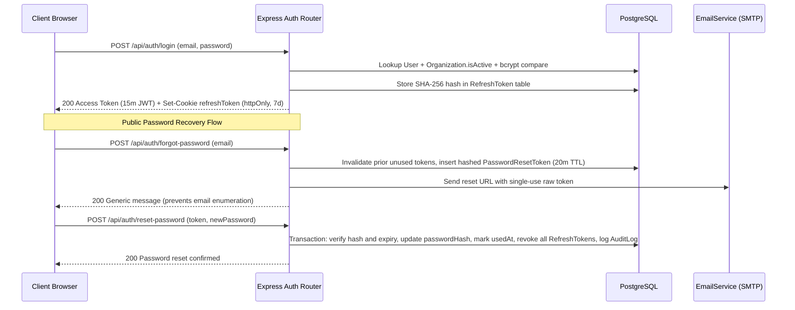
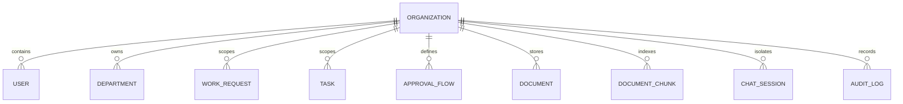
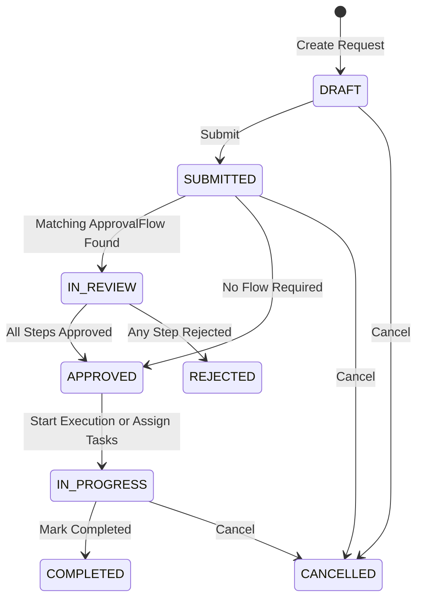
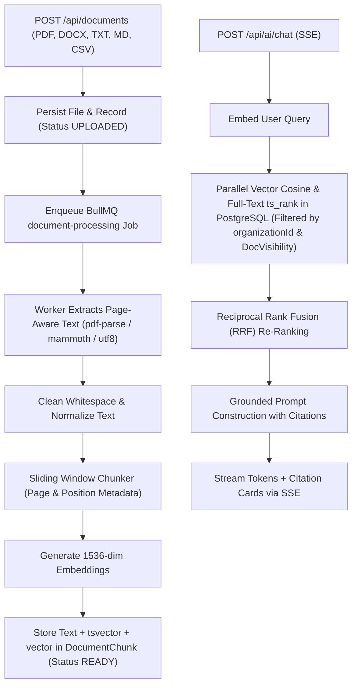

# NexusOps AI System Architecture

## 1. System Overview

NexusOps AI is a multi-tenant enterprise operations platform combining internal work-request workflows, configurable multi-step approvals, task execution, knowledge base document management, Retrieval-Augmented Generation (RAG) Q&A with page-level citations, operational analytics, and HR/Finance modules (leave management, expense claims, IT asset inventory, compliance policies, company directory, announcements, and CSAT surveys).

### Core Stack

| Layer | Technology | Purpose |
| --- | --- | --- |
| Frontend | React 19, TypeScript, Vite, Tailwind CSS, TanStack Query, React Hook Form, Zod, Recharts | Role-aware SPA delivered via Nginx reverse proxy |
| API Server | Node.js 20, Express 5, TypeScript, Zod, Helmet, Pino | REST API, JWT authentication, RBAC/tenant enforcement, SSE AI streaming, Swagger UI (`/api/docs`) |
| Background Worker | BullMQ (`document-processing`, `approval-escalation`, `analytics-digest`) | Asynchronous document chunking/embedding, SLA escalation scans, scheduled digest delivery |
| Database & Vector Store | PostgreSQL 16 + `pgvector` extension, Prisma ORM | Relational multi-tenant data model, `tsvector` full-text search, and 1536-dim cosine vector similarity |
| Cache & Queue Broker | Redis 7 + `ioredis` | BullMQ job queue backend and retry scheduling |
| AI Providers | Anthropic (`@anthropic-ai/sdk`) & OpenAI / pluggable `mock` providers | Citation-grounded LLM streaming and vector embeddings |

---

## 2. High-Level Container & Service Topology

### Process Responsibilities

1. **`frontend` (Nginx)**: Serves the compiled Vite production bundle with SPA fallback (`try_files $uri $uri/ /index.html`) and proxies `/api/*` directly to `http://backend:4000/api/` with `proxy_buffering off` and extended read timeouts so Server-Sent Events (SSE) token streams render incrementally.
2. **`backend` (`dist/server.js`)**: Runs the Express HTTP server handling authentication, RBAC, multi-tenant CRUD, Swagger docs (`/api/docs` & `/api/docs.json`), SSE AI responses, and BullMQ job enqueueing.
3. **`worker` (`dist/worker.js`)**: Dedicated background Node process consuming three BullMQ queues:
   - `document-processing` (concurrency `5`, exponential backoff `1s` up to 3 attempts)
   - `approval-escalation` (repeatable interval scan via `ESCALATION_CHECK_INTERVAL_MINUTES`)
   - `analytics-digest` (repeatable interval scan sending scheduled weekly digests)
4. **`migrate`**: One-shot init container running `npx prisma migrate deploy` after PostgreSQL healthcheck passes and before `backend` and `worker` start.

---

## 3. Authentication, Token Rotation & Password Recovery

NexusOps AI splits authentication into short-lived bearer tokens stored in browser memory and long-lived refresh tokens stored in `httpOnly` cookies, backed by server-side hashed token persistence.

### Security Controls

- **Rate Limiting**: `loginRateLimiter` and `forgotPasswordRateLimiter` defend authentication and recovery endpoints against brute-force or mail-spamming bursts.
- **Revocation on Reset**: Consuming a `PasswordResetToken` revokes every active `RefreshToken` row for that user inside the same Prisma transaction.
- **Helmet & CORS**: `helmet()` hardens response headers globally (with Swagger UI CSP exceptions scoped strictly to `/api/docs`), and `CORS_ORIGINS` strictly controls allowed browser origins with `credentials: true`.

---

## 4. Multi-Tenancy & RBAC Governance

NexusOps AI enforces tenant isolation at every layer so organizations never see or collide with each other's users, departments, requests, documents, or AI vector chunks.

### Role Hierarchy & Enforcement

1. **`EMPLOYEE`**: Raises work requests, updates personal tasks, acknowledges policies, requests leave, submits expense claims, and queries AI Assistant on permitted documents.
2. **`MANAGER`**: Includes all employee capabilities plus departmental approval actions, task assignment, announcement publishing, and departmental analytics.
3. **`ADMIN`**: Full organization-level governance across user roles, document uploads/deletions, approval flow configuration, assets, holidays, surveys, compliance exports, and audit logs within their own `organizationId`.
4. **`SUPER_ADMIN`**: Platform-level governance role (`organizationId` nullable). Satisfies all `ADMIN` checks via `authorize()` and holds exclusive `authorizeExact(Role.SUPER_ADMIN)` access to `/api/organizations` to create, inspect, suspend, or reactivate tenant workspaces.

### Tenant Isolation Guarantees

- **Schema-Level Scoping**: All tenant entities include an indexed `organizationId` foreign key. Models with natural business keys use tenant-scoped composite uniques (`Department`: `[organizationId, name]`, `Holiday`: `[organizationId, date]`, `Asset`: `[organizationId, serialNumber]`, `ExpenseClaim`: `[organizationId, paymentReference]`).
- **Active Tenant Gate**: The `authenticate` middleware queries `Organization.isActive` for every non-`SUPER_ADMIN` JWT request and immediately rejects requests from suspended tenants with `403 Forbidden`.
- **Utility Enforcement**: `resolveTenantId`, `tenantWhere`, and `assertSameTenant` in `apps/api/src/lib/tenant.ts` bind repository writes/queries and reject cross-tenant primary-ID probes with `404 Not Found` (preventing ID enumeration) or `403 Forbidden` when an explicit foreign `organizationId` parameter is supplied.
- **Vector SQL Isolation**: Raw PostgreSQL similarity and full-text SQL in `apps/api/src/modules/ai/retrieval.service.ts` embeds `"organizationId"` and `DocVisibility` predicates directly inside the SQL `WHERE` clause before `ORDER BY ... LIMIT`, ensuring no unauthorized chunk can enter LLM context.

---

## 5. Work Request & Multi-Step Approval Lifecycle

Work requests progress through validated state transitions backed by rule-matched multi-step approvals and automatic escalation checks.

- **Configurable Flows**: `ApprovalFlow` rules match by optional request category and minimum priority (`LOW` through `URGENT`), instantiating ordered `ApprovalStep` rows (`MANAGER` -> `ADMIN` -> specific approver).
- **Escalation Engine**: `approvalEscalationService.checkAndEscalateOverdueApprovals` scans pending steps older than `ESCALATION_AFTER_HOURS` (default `72h`) on the BullMQ repeatable interval (`ESCALATION_CHECK_INTERVAL_MINUTES`), logs audit entries, and notifies fallback approvers.

---

## 6. RAG Document Ingestion & Hybrid Retrieval Pipeline

Enterprise knowledge documents pass through an asynchronous ingestion pipeline cleanly decoupled from HTTP upload latency.

### Permission-Aware Retrieval Rules

1. Every chunk inherits `organizationId` and parent `Document` visibility (`ALL`, `DEPARTMENT`, `MANAGERS`, `ADMIN_ONLY`).
2. `buildPermissionFilterSql` constrains SQL queries BEFORE top-K selection so cross-tenant or restricted documents (`ADMIN_ONLY`, foreign `DEPARTMENT`) never surface in retrieval results or prompt context.
3. Responses cite source documents with exact titles and page numbers (`[Document Title, p. N]`), and record token/cost metrics in `AiMessage` / `ChatSession` for `/api/analytics/ai-usage`.
